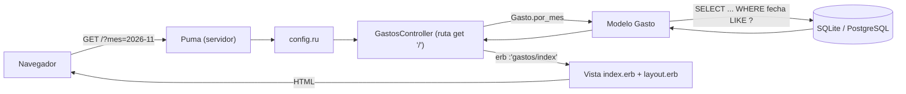

# Guía: aprende Ruby con tu propio proyecto

Esta guía va de lo más básico a cómo funciona tu app de gastos. Cada concepto trae un ejemplo **sacado de tu código**, así que puedes abrir el archivo y verlo en contexto.

---

## Parte 1 — Cómo se ejecuta Ruby

Ruby es un lenguaje **interpretado**: escribes un archivo `.rb` y el programa `ruby` lo lee y lo ejecuta línea por línea. No hay paso de compilación.

Tienes dos formas de usarlo:

| Forma | Comando | Para qué |
|---|---|---|
| Ejecutar un archivo | `ruby ejercicios.rb` | Programas completos |
| Consola interactiva | `irb` | Probar cosas rápido, línea por línea |

**Pruébalo ahora.** En la terminal escribe `irb` y luego:

```ruby
1 + 2            # => 3
"hola".upcase    # => "HOLA"
[3, 1, 2].sort   # => [1, 2, 3]
exit             # para salir
```

> `#` inicia un comentario. Ruby lo ignora.

---

## Parte 2 — Lo básico del lenguaje

### 2.1 Variables y tipos

No se declara el tipo; Ruby lo deduce.

```ruby
descripcion = "Supermercado"   # String (texto)
monto       = 84.50            # Float (decimal)
cantidad    = 3                # Integer (entero)
pagado      = true             # Boolean
nota        = nil              # nil = "nada", como null
```

### 2.2 Textos e interpolación

Con comillas dobles puedes meter código dentro de `#{ }`:

```ruby
mes = "2026-11"
"Total de #{mes}"         # => "Total de 2026-11"
```

En tu proyecto ([gastos_controller.rb](app/controllers/gastos_controller.rb)):

```ruby
redirect "/?mes=#{@gasto.mes}&notice=creado"
```

### 2.3 Arreglos (Array)

Listas ordenadas:

```ruby
CATEGORIAS = %w[Alimentación Transporte Servicios Salud Ocio Otros]
# %w[...] es un atajo para ["Alimentación", "Transporte", ...]

CATEGORIAS.first              # => "Alimentación"
CATEGORIAS.include?("Ocio")   # => true
CATEGORIAS.size               # => 6
```

> Los métodos que terminan en `?` devuelven `true`/`false`. Es una convención de Ruby.

### 2.4 Hashes (diccionarios)

Pares clave → valor:

```ruby
gasto = { "descripcion" => "Cine", "monto" => 38.90 }
gasto["monto"]   # => 38.9
```

Con **símbolos** (`:nombre`) como claves, que es lo más común:

```ruby
gasto = { descripcion: "Cine", monto: 38.90 }
gasto[:monto]    # => 38.9
```

En [application_helper.rb](app/helpers/application_helper.rb) usamos un hash para elegir el color de cada categoría:

```ruby
BADGES = { 'Alimentación' => 'badge-food', 'Transporte' => 'badge-transport' }
BADGES.fetch('Ocio', 'badge-other')   # si no existe la clave, usa 'badge-other'
```

### 2.5 Condiciones

```ruby
if monto > 100
  puts "Gasto alto"
elsif monto > 50
  puts "Gasto medio"
else
  puts "Gasto bajo"
end

# Versión de una línea:
puts "Cero" if monto.zero?

# unless = "si NO"
puts "Hay errores" unless errores.empty?
```

Operador ternario (si ? entonces : si no), usado en tu layout:

```ruby
Database.postgres? ? 'PostgreSQL' : 'SQLite3 Local'
```

### 2.6 Métodos (funciones)

Se definen con `def` y terminan con `end`. **La última línea se devuelve sola**, no hace falta `return`.

```ruby
def mes
  fecha.to_s[0, 7]     # "2026-11-15"[0, 7] => "2026-11"
end
```

Con parámetros (de [application_helper.rb](app/helpers/application_helper.rb)):

```ruby
def porcentaje(parte, total)
  total.positive? ? format('%.0f%%', parte / total * 100) : '0%'
end

porcentaje(25, 100)   # => "25%"
```

Los paréntesis al llamar son opcionales: `puts("hola")` y `puts "hola"` son lo mismo.

### 2.7 Bloques — lo más característico de Ruby

Un bloque es un trozo de código que le pasas a un método, entre `do ... end` o `{ ... }`.

```ruby
[10, 20, 30].each do |numero|
  puts numero
end

[10, 20, 30].each { |numero| puts numero }   # igual, en una línea
```

`|numero|` es el nombre que le das a cada elemento. Métodos con bloques que verás mucho:

```ruby
montos = [84.5, 42.0, 25.0]

montos.map { |m| m * 2 }        # transforma cada uno  => [169.0, 84.0, 50.0]
montos.select { |m| m > 30 }    # filtra               => [84.5, 42.0]
montos.sum                      # suma                 => 151.5
montos.sort_by { |m| -m }       # ordena (mayor primero)
```

En tu modelo, así se calcula el **desglose por categoría** ([gasto.rb](app/models/gasto.rb)):

```ruby
def self.desglose_por_categoria(gastos)
  gastos.group_by(&:categoria)                       # 1. agrupa: {"Ocio" => [g1, g2], ...}
        .transform_values { |lista| total(lista) }   # 2. cambia cada lista por su suma
        .sort_by { |_, subtotal| -subtotal }         # 3. ordena del mayor al menor
end
```

> `&:categoria` es un atajo de `{ |g| g.categoria }`.

### 2.8 Clases y objetos

Una clase es un molde; cada objeto creado con `.new` es una copia con sus propios datos.

```ruby
class Gasto
  attr_accessor :descripcion, :monto   # crea automáticamente gasto.monto y gasto.monto = 5

  def initialize(descripcion, monto)   # se ejecuta al hacer Gasto.new
    @descripcion = descripcion          # @variable = dato propio de ESTE objeto
    @monto = monto
  end

  def caro?
    @monto > 50
  end
end

cine = Gasto.new("Cine", 38.90)
cine.monto     # => 38.9
cine.caro?     # => false
```

Diferencia importante:

| Tipo | Se define con | Se llama así | Ejemplo en tu app |
|---|---|---|---|
| Método de **instancia** | `def guardar` | `gasto.save` | actúa sobre UN gasto |
| Método de **clase** | `def self.all` | `Gasto.all` | actúa sobre la tabla completa |

### 2.9 Módulos y `require`

- Un **módulo** agrupa métodos que se pueden incluir en otras clases (`ApplicationHelper`, `Database`).
- `require 'sinatra/base'` carga una gema.
- `require_relative 'database'` carga un archivo tuyo, con ruta relativa al archivo actual.

Mira [config/environment.rb](config/environment.rb): es solo una lista de `require` en el orden correcto.

---

## Parte 3 — Gemas y Bundler

Una **gema** es una librería de Ruby (como un paquete de npm o pip).

| Archivo / comando | Qué hace |
|---|---|
| [Gemfile](Gemfile) | Lista de gemas que necesita el proyecto |
| `bundle install` | Descarga e instala esas gemas |
| `Gemfile.lock` | Guarda las versiones exactas instaladas (no se edita a mano) |
| `bundle exec puma` | Ejecuta `puma` usando exactamente esas versiones |

Tus gemas:

- **sinatra**: el framework web (rutas, vistas).
- **puma**: el servidor que recibe las peticiones del navegador.
- **sqlite3** / **pg**: hablan con la base de datos.
- **dotenv**: lee variables del archivo `.env`.

---

## Parte 4 — Cómo funciona tu app web

### 4.1 El viaje de una petición

Cuando abres `http://localhost:4567/?mes=2026-11`:



1. **Puma** recibe la petición.
2. **[config.ru](config.ru)** carga la app y le pasa la petición a `GastosController`.
3. El **controlador** busca la ruta que coincide (`get '/'`).
4. Le pide los datos al **modelo** (`Gasto.por_mes(@mes)`).
5. El modelo hace la **consulta SQL** y devuelve objetos `Gasto`.
6. El controlador guarda los datos en variables `@algo` y llama a la **vista**.
7. La vista ERB genera **HTML** y Puma lo devuelve al navegador.

### 4.2 Una ruta de Sinatra

```ruby
get '/' do            # cuando llegue un GET a "/"
  @mes = Gasto.normalizar_mes(params[:mes])   # params = datos de la URL o del formulario
  cargar_resumen
  erb :'gastos/index'                         # muestra app/views/gastos/index.erb
end
```

- `get`, `post`, `patch`, `delete` = el **método HTTP**.
- `params[:mes]` = lo que vino en la URL (`?mes=...`) o en un formulario (`name="mes"`).
- Las variables con `@` quedan **disponibles en la vista**.

### 4.3 Vistas ERB (HTML + Ruby)

ERB es HTML con dos etiquetas especiales:

| Etiqueta | Qué hace | Ejemplo |
|---|---|---|
| `<% codigo %>` | Ejecuta Ruby, **no imprime** | `<% @gastos.each do \|gasto\| %>` |
| `<%= codigo %>` | Ejecuta Ruby **e imprime** el resultado | `<%= h(gasto.descripcion) %>` |

```erb
<% @gastos.each do |gasto| %>
  <tr>
    <td><%= h(gasto.fecha) %></td>
    <td><%= h(gasto.descripcion) %></td>
  </tr>
<% end %>
```

> **Siempre** usa `h(...)` al imprimir datos del usuario. Convierte `<script>` en texto inofensivo (protección contra XSS).

### 4.4 Recorrido completo: "Guardar gasto"

1. En [index.erb](app/views/gastos/index.erb), el formulario tiene `action="/gastos" method="post"`. Cada `<input name="monto">` se convierte en `params["monto"]`.
2. En [gastos_controller.rb](app/controllers/gastos_controller.rb):
   ```ruby
   post '/gastos' do
     @gasto = Gasto.new(gasto_params)   # crea el objeto con lo que llegó
     if @gasto.save                      # intenta guardar
       redirect "/?mes=..."             # éxito: vuelve al listado
     else
       erb :'gastos/index'               # error: vuelve a mostrar el formulario con errores
     end
   end
   ```
3. En [gasto.rb](app/models/gasto.rb), `save` primero llama a `valid?`. Si algo está mal, agrega mensajes a `errors` y devuelve `false`.
4. Si todo está bien, ejecuta:
   ```ruby
   Database.execute('INSERT INTO gastos (descripcion, monto, categoria, fecha) VALUES (?, ?, ?, ?)',
                    [descripcion, monto, categoria, fecha])
   ```
   Los `?` se reemplazan de forma segura por los valores (protección contra inyección SQL).

### 4.5 Quién hace qué (MVC)

| Capa | Carpeta | Responsabilidad | Pregunta que responde |
|---|---|---|---|
| **Modelo** | `app/models` | Datos y reglas | "¿Es válido? ¿Cuánto suma?" |
| **Vista** | `app/views` | Presentación | "¿Cómo se ve?" |
| **Controlador** | `app/controllers` | Coordinar | "¿Qué hago con esta petición?" |

---

## Parte 5 — Ejercicios

### Nivel 1: lenguaje (sin tocar la app)

Ejecuta el archivo de práctica y luego modifícalo:

```powershell
ruby ejercicios.rb
```

### Nivel 2: cambios pequeños en la app

Después de cada cambio, detén el servidor (`Ctrl + C`) y vuelve a arrancarlo con `bundle exec puma`.

1. **Agrega la categoría "Educación".**
   Pista: solo hay que tocar la constante `CATEGORIAS` en [gasto.rb](app/models/gasto.rb). ¿Por qué aparece sola en el formulario y en la validación?
2. **Cambia el mensaje** "Gasto registrado correctamente." por otro.
   Pista: busca el hash `AVISOS` en [application_helper.rb](app/helpers/application_helper.rb).
3. **Nueva validación:** que el monto no pueda pasar de 100,000.
   Pista: en `validar_monto`, añade otra condición y un `errors << '...'`.

### Nivel 3: una ruta nueva

4. Crea `get '/hola/:nombre'` en el controlador que devuelva `"Hola, #{params[:nombre]}"`. Visita `/hola/Ana`.
5. Muestra el **gasto más caro** del mes en la vista. Pista: en `cargar_resumen` usa `@gastos.max_by(&:monto_valor)`.

---

## Errores comunes

| Mensaje | Causa probable |
|---|---|
| `'ruby' no se reconoce...` | Cierra y abre la terminal después de instalar Ruby |
| `undefined method 'x' for nil` | Una variable es `nil`; revisa que `@variable` se haya asignado en el controlador |
| `undefined local variable or method` | Error de escritura o falta `@` en una variable |
| `syntax error, unexpected end` | Te sobra o te falta un `end` |
| Los cambios no aparecen | Reinicia el servidor (`Ctrl + C` y `bundle exec puma`) |
| `Address already in use` | Ya hay otro servidor en el puerto 4567; ciérralo |

---

## Siguiente paso

- Documentación oficial en español: https://www.ruby-lang.org/es/documentation/
- Ruby en 20 minutos: https://www.ruby-lang.org/es/documentation/quickstart/
- Sinatra: https://sinatrarb.com/intro-es.html
